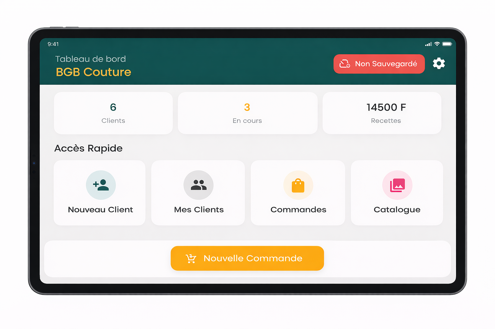

# TAILLEUR TCHÉKÉ - OFFLINE-FIRST BUSINESS MANAGEMENT FOR TAILORS

> Offline-first mobile solution empowering West African tailors to digitize their workshops


---

## ⚠️ Repository Notice

This is a **technical showcase repository** demonstrating the architecture and design decisions of an offline-first mobile application for artisan businesses. The actual production codebase is proprietary.

**This repository includes:**
- Offline-first architecture documentation
- Local database design (Isar NoSQL)
- Firebase cloud sync strategy
- Data modeling & relationships
- Technical decision records

---

## 📋 Table of Contents

- [Overview](#overview)
- [Problem & Solution](#problem--solution)
- [System Architecture](#system-architecture)
- [Technical Stack](#technical-stack)
- [Key Features](#key-features)
- [Data Models](#data-models)
- [Offline-First Architecture](#offline-first-architecture)
- [Cloud Sync Strategy](#cloud-sync-strategy)
- [Technical Challenges](#technical-challenges)
- [Business Model](#business-model)
- [Roadmap](#roadmap)
- [Screenshots](#screenshots)

---

## 🎯 Overview

**Tailleur Tchéké** is a complete business management solution designed specifically for West African tailors, combining **hardware (tablet) + software (offline-first Flutter app)** to digitize workshop operations in low-connectivity environments.

The app works **100% offline** by default, syncing to the cloud only when internet is available and the tailor has a Premium subscription.

### Quick Stats

| Metric | Value |
|--------|-------|
| **Status** | MVP tested with real tailors |
| **Tailors Testing** | ~5 artisans (Niger) |
| **Target Market** | Niger (expanding to West Africa) |
| **Offline Capability** | 100% functional without internet |
| **Development Period** | January 2026 - Present |
| **Platform** | Android tablets (iOS support ready) |

---

## 🔍 Problem & Solution

### The Challenge

West African tailors face critical business management issues:

- ❌ **Paper-based records** - Client measurements on notebooks, easily lost/damaged
- ❌ **No client history** - Can't track past orders, preferences, or outstanding payments
- ❌ **Memory-dependent** - Rely on memory for deadlines, prices, fabric details
- ❌ **No financial tracking** - Revenue, expenses, debts tracked manually (if at all)
- ❌ **Limited connectivity** - Frequent power outages, expensive/unreliable internet
- ❌ **Low digital literacy** - Traditional smartphone apps too complex

### Our Solution

A **hardware + software kit** designed for African artisan realities:

✅ **100% offline-first** - Works without internet (sync when available)  
✅ **Tablet included** - Pre-configured Android tablet in hardware kit  
✅ **Simple interface** - Tailored for low digital literacy  
✅ **Complete client records** - Photos, measurements, order history  
✅ **Visual catalog** - Browse fabric/model photos with clients  
✅ **Payment tracking** - Installments, debts, receipts (FCFA currency)  
✅ **Cloud backup** - Premium users sync to Firebase (automatic recovery)  
✅ **Camera integration** - Capture fabric photos, client references  

---

## 🏗️ System Architecture

### Offline-First Design Philosophy

```
┌─────────────────────────────────────────────┐
│         Tailor (Android Tablet)             │
│   - Workshop with intermittent power        │
│   - Mobile data often unavailable           │
└──────────────┬──────────────────────────────┘
               │
    ┌──────────▼───────────┐
    │  Flutter App (Local) │
    │  - 100% functional   │
    │  - No internet needed│
    └──────────┬───────────┘
               │
    ┌──────────▼───────────┐
    │   Isar Database      │
    │   (Local NoSQL)      │
    │                      │
    │  ┌────────────────┐  │
    │  │ Clients        │  │
    │  │ Measurements   │  │
    │  │ Orders         │  │
    │  │ Payments       │  │
    │  │ Catalog        │  │
    │  └────────────────┘  │
    └──────────┬───────────┘
               │
    ┌──────────▼───────────┐ (OPTIONAL - Premium only)
    │  Connectivity Check  │
    │  (connectivity_plus) │
    └──────────┬───────────┘
               │
               │ When internet available
               │ + Premium subscription
               ▼
    ┌──────────────────────┐
    │   Cloud Sync         │
    │   (Firebase)         │
    │                      │
    │  - Firestore (data)  │
    │  - Auth (optional)   │
    │  - Storage (photos)  │
    └──────────────────────┘
```

**Key Architecture Principles:**

1. **Local-first, cloud-optional**
   - App fully functional offline (Isar database)
   - Cloud sync is a **backup feature**, not a requirement
   - Premium subscription unlocks cloud sync

2. **Smart sync triggers**
   - Automatic sync when WiFi detected
   - Manual "Sync Now" button for mobile data users
   - Batch uploads (efficiency on slow connections)

3. **Conflict resolution**
   - Tablet is source of truth (tailor's active device)
   - Cloud restoration overwrites local (full account recovery scenario)
   - No multi-device editing (one tablet = one tailor)

---

## 🛠️ Technical Stack

### Mobile App
- **Framework:** Flutter 3.3+ (Dart)
- **State Management:** Provider (simple, beginner-friendly for future contributors)
- **UI Design:** Material Design (familiar Android patterns)
- **Camera:** image_picker (fabric/client photos)
- **Image Compression:** flutter_image_compress (save storage, faster sync)

### Local Database
- **Engine:** Isar 3.1.0 (NoSQL, ultra-fast)
- **Why Isar over SQLite?**
  - 10x faster queries (critical for low-spec tablets)
  - Schema-less (easier to evolve data model)
  - Built-in indexes (optimized search)
  - Smaller storage footprint

### Cloud Services (Premium Feature)
- **Backend:** Firebase
  - **Firestore:** Document storage (client/order data)
  - **Cloud Storage:** Image backups (photos compressed)
  - **Auth:** (Optional, currently unused - single-device model)
- **Connectivity Detection:** connectivity_plus (WiFi vs Mobile Data vs Offline)

### Utilities
- **Localization:** intl (FCFA currency, French date formats)
- **Typography:** google_fonts (readable fonts for low-light workshops)
- **Package Info:** package_info_plus (version tracking for support)

### Development Tools
- **Build Runner:** Isar code generation (`.g.dart` files)
- **Linting:** flutter_lints (code quality)

---

## ✨ Key Features

### 📦 Core Features (Available Offline)

#### **Client Management**
- ✅ **Complete profiles**
  - Name, phone, gender, city
  - Photo (optional, camera capture)
  - Custom notes (preferences, special requests)
  
- ✅ **Comprehensive measurements** (23 fields)
  - **Upper body:** Shoulders, chest, waist, neck, sleeve length, arm circumference, back width
  - **Lower body:** Belt, hips, thigh, pant length, inseam, knee, ankle
  - **Garment-specific:** Boubou length, dress length
  - **Custom field:** Free-text for special measurements
  
- ✅ **Measurement history**
  - Last measurement date tracked
  - Update measurements over time (weight changes)

- ✅ **Order history per client**
  - See all past orders (fabric, price, delivery)
  - Repeat orders (one-tap duplicate)

---

#### **Catalog Management**
- ✅ **Visual model library**
  - Photo of garment style (upload from gallery/camera)
  - Model name, category (men, women, unisex)
  - Base price per model
  
- ✅ **Favorites**
  - Mark popular models (quick access)
  
- ✅ **Categories**
  - Organize by garment type (shirt, pants, boubou, dress, etc.)

**Use Case:** Tailor shows catalog to client on tablet, client picks model, tailor creates order.

---

#### **Order Management**
- ✅ **Order creation workflow**
  1. Select client (search by name/phone)
  2. Pick catalog model (optional - custom orders supported)
  3. Add fabric details (description, photos of fabric)
  4. Set total price
  5. Set delivery date
  
- ✅ **Order statuses**
  - **En Attente** (Pending) - Just placed
  - **En Cours** (In Progress) - Tailor is sewing
  - **Prêt** (Ready) - Finished, awaiting pickup
  - **Livré** (Delivered) - Client picked up
  - **Annulé** (Cancelled) - Order cancelled
  
- ✅ **Status-based filtering**
  - View only "In Progress" orders (today's work queue)
  - See all "Ready" orders (pending pickups)
  
- ✅ **Fabric photo gallery**
  - Attach multiple photos per order (fabric texture, color, pattern)
  - View photos during sewing (reference)

---

#### **Payment Tracking**
- ✅ **Linked to orders**
  - Each payment tied to specific order
  
- ✅ **Partial payments supported**
  - Client pays deposit (e.g., 10,000 FCFA of 25,000 FCFA total)
  - Track remaining balance per order
  
- ✅ **Payment methods**
  - Cash (Espèces)
  - Mobile Money (Orange Money, Moov Money)
  - Bank Transfer
  
- ✅ **Payment history**
  - Date, amount, method recorded
  - View all payments for an order

**Financial Insight:** Tailor knows exactly who owes what, when payments were made.

---

#### **Dashboard (Home Screen)**
- ✅ **Key metrics at a glance**
  - Total clients registered
  - Orders in progress (work queue)
  - Total revenue (FCFA) - all-time or filtered by period
  
- ✅ **Quick actions**
  - Add new client
  - Create new order
  - View pending deliveries

---

### ☁️ Premium Features (Requires Subscription + Internet)

#### **Cloud Sync**
- ✅ **Automatic backup** when connected
  - All clients, orders, payments synced to Firestore
  - Photos uploaded to Firebase Cloud Storage (compressed)
  
- ✅ **Account recovery**
  - If tablet breaks/stolen, tailor can restore full account
  - Enter phone number → downloads all data from cloud
  
- ✅ **Sync status indicator**
  - Visual icon showing "Synced" vs "Pending sync"
  - Last sync timestamp displayed

#### **Premium Subscription Check**
- ✅ **Subscription validation**
  - `isPremium` flag in Tailor model
  - `subscriptionEndDate` checked before sync
  
- ✅ **Grace period** (planned)
  - 7 days after expiration before cloud access revoked
  - Reminders to renew

---

## 🗄️ Data Models

### Core Entities (Isar Collections)

#### **1. Tailleur (Tailor Profile)**
```dart
@collection
class Tailleur {
  Id id = Isar.autoIncrement;
  
  // Identity
  String nomAtelier;           // Workshop name (e.g., "Atelier Tchéké")
  String telephone;            // Phone number (login identifier)
  String? email;               // Optional email
  
  // Subscription (Premium)
  bool isPremium = false;
  DateTime? subscriptionEndDate;
  
  // Cloud linkage
  String? uidCloud;            // Firebase UID (if synced)
  
  // Settings
  String? smsTemplate;         // Custom SMS for client reminders
  DateTime dateCreation = DateTime.now();
}
```

**Note:** Currently **single-tailor per tablet** model. Multi-user login planned for workshops with employees.

---

#### **2. Client (Customer)**
```dart
@collection
class Client {
  Id id = Isar.autoIncrement;
  
  // Identity
  String nomComplet;           // Full name
  String? telephone;           // Phone (optional, but recommended)
  String sexe = "H";           // M (Homme) or F (Femme)
  String? ville;               // City/neighborhood
  String? notes;               // Custom notes (e.g., "Prefers tight fit")
  
  // Photo
  String? photoPath;           // Local file path (not synced, just reference)
  
  // Measurements (embedded object)
  final mesures = Mesures();   // See Mesures class below
  
  // Metadata
  DateTime dateCreation = DateTime.now();
  bool isDeleted = false;      // Soft delete (preserve order history)
  
  // Sync tracking
  bool isSynced = false;
  DateTime lastUpdated = DateTime.now();
}
```

**Mesures (Embedded Object in Client):**
```dart
@embedded
class Mesures {
  DateTime? lastMesureDate;
  
  // Upper body
  double? epaule;        // Shoulders
  double? poitrine;      // Chest
  double? taille;        // Waist
  double? cou;           // Neck
  double? longManche;    // Sleeve length
  double? tourBras;      // Arm circumference
  double? carrureDos;    // Back width
  
  // Lower body
  double? ceinture;      // Belt
  double? bassin;        // Hips
  double? cuisse;        // Thigh
  double? longPantalon;  // Pant length
  double? entreJambe;    // Inseam
  double? tourGenou;     // Knee circumference
  double? basPantalon;   // Ankle
  
  // Specific garments
  double? longBoubou;    // Traditional robe length
  double? longRobe;      // Dress length
  
  // Custom
  String? autre;         // Free text for special measurements
}
```

**Why separate Mesures class?**
- Cleaner code (23 fields would clutter Client model)
- Reusable (future: measurement templates)
- Embedded = stored in same document (fast queries)

---

#### **3. Catalogue (Garment Models)**
```dart
@collection
class Catalogue {
  Id id = Isar.autoIncrement;
  
  String nom;                  // Model name (e.g., "Chemise Col Mao")
  String categorie;            // "Homme", "Femme", "Mixte"
  double prixDeBase = 0;       // Base price (FCFA)
  
  String? photoPath;           // Local photo path
  bool favori = false;         // Quick access flag
  
  // Metadata
  bool isDeleted = false;
  bool isSynced = false;
  DateTime lastUpdated = DateTime.now();
}
```

---

#### **4. Commande (Order)**
```dart
@collection
class Commande {
  Id id = Isar.autoIncrement;
  
  // Relationships (Isar links)
  final client = IsarLink<Client>();       // Required: Who ordered?
  final catalogue = IsarLink<Catalogue>(); // Optional: Which model?
  
  // Order details
  String? description;         // Fabric type, color, custom requests
  List<String>? photosTissu;   // Fabric photo paths (multiple images)
  double prixTotal = 0;        // Total price (FCFA)
  
  // Status workflow
  @Index()
  String statut = "En Attente"; // Indexed for fast filtering
  
  // Dates
  DateTime dateDepot = DateTime.now();          // Order placed
  late DateTime dateLivraisonPrevue;           // Expected delivery
  DateTime? dateLivraisonReelle;               // Actual delivery
  
  // Sync tracking
  bool isSynced = false;
  DateTime lastUpdated = DateTime.now();
}
```

**IsarLink Explained:**
- `client.value` → Get linked Client object
- Lazy-loaded (not fetched until accessed)
- Foreign key relationship (client deletion blocks if orders exist)

---

#### **5. Paiement (Payment)**
```dart
@collection
class Paiement {
  Id id = Isar.autoIncrement;
  
  // Relationship
  final commande = IsarLink<Commande>();  // Which order?
  
  // Payment details
  double montant = 0;                    // Amount (FCFA)
  DateTime datePaiement = DateTime.now();
  String moyenPaiement = "Espèces";      // Cash, Mobile Money, Bank
  
  // Sync tracking
  bool isSynced = false;
}
```

**Payment Flow:**
1. Order created (prixTotal = 25,000 FCFA)
2. Client pays deposit (Paiement: montant = 10,000)
3. Remaining balance = 15,000 (calculated on-the-fly)
4. Client pays rest (Paiement: montant = 15,000)
5. Order fully paid (sum of payments = prixTotal)

---

## 🔌 Offline-First Architecture

### How It Works (Technical Deep Dive)

#### **1. App Launch (No Internet)**

```dart
// main.dart (simplified)
void main() async {
  WidgetsFlutterBinding.ensureInitialized();
  
  // Initialize Isar (local database)
  final isar = await Isar.open([
    ClientSchema,
    CommandeSchema,
    PaiementSchema,
    CatalogueSchema,
    TailleurSchema,
  ]);
  
  // Check if tailor account exists (onboarding)
  final tailleur = await isar.tailleurs.where().findFirst();
  
  runApp(MyApp(
    startScreen: tailleur == null 
      ? OnboardingScreen()  // First launch
      : HomeScreen()        // Existing account
  ));
}
```

**No Firebase initialization at launch** → App works offline immediately.

---

#### **2. Onboarding (First-Time Setup)**

```dart
// screens/onboarding_screen.dart (simplified)
Future<void> createAtelier(String nom, String telephone) async {
  final isar = Isar.getInstance();
  
  final newTailleur = Tailleur()
    ..nomAtelier = nom
    ..telephone = telephone
    ..isPremium = false  // Start as free user
    ..dateCreation = DateTime.now();
  
  await isar.writeTxn(() async {
    await isar.tailleurs.put(newTailleur);
  });
  
  // Navigate to home screen
}
```

**No cloud involved** → Tailor can start working immediately.

---

#### **3. Daily Operations (100% Offline)**

**Adding a client:**
```dart
// services/client_service.dart (simplified)
Future<void> addClient(Client client) async {
  final isar = Isar.getInstance();
  
  await isar.writeTxn(() async {
    client.isSynced = false;  // Mark as "not yet synced"
    await isar.clients.put(client);
  });
}
```

**Creating an order:**
```dart
// services/commande_service.dart (simplified)
Future<void> createCommande(Commande commande) async {
  final isar = Isar.getInstance();
  
  await isar.writeTxn(() async {
    // Save order
    commande.isSynced = false;
    await isar.commandes.put(commande);
    
    // Link to client (Isar relationship)
    await commande.client.save();
  });
}
```

**All operations write to Isar** → No network requests.

---

#### **4. Cloud Sync (When Internet Available + Premium)**

**Sync trigger:**
```dart
// screens/settings_screen.dart
if (isPremium && hasInternet) {
  showButton("Synchroniser maintenant");
}

onPressed: () async {
  await SyncService().syncAll();  // See sync implementation below
}
```

**Sync flow (simplified):**
```dart
// services/sync_service.dart
Future<void> syncAll() async {
  // 1. Check preconditions
  if (!await checkInternet()) return;
  if (!await checkPremium()) return;
  
  // 2. Sync each collection
  await _syncClients();
  await _syncCatalogue();
  await _syncCommandes();
  await _syncPaiements();
  
  print("Sync complete!");
}

Future<void> _syncClients() async {
  // Get unsynced clients
  final unsyncedClients = await isar.clients
    .filter()
    .isSyncedEqualTo(false)
    .findAll();
  
  if (unsyncedClients.isEmpty) return;
  
  // Batch upload to Firestore
  final batch = FirebaseFirestore.instance.batch();
  
  for (var client in unsyncedClients) {
    final docRef = FirebaseFirestore.instance
      .collection('tailleurs')
      .doc(tailleur.uidCloud)
      .collection('clients')
      .doc(client.id.toString());
    
    batch.set(docRef, {
      'nom': client.nomComplet,
      'tel': client.telephone,
      'sexe': client.sexe,
      'mesures': {
        'epaule': client.mesures.epaule,
        'poitrine': client.mesures.poitrine,
        // ... all 23 measurement fields
      },
      'last_updated': FieldValue.serverTimestamp(),
    });
  }
  
  await batch.commit();
  
  // Mark as synced locally
  await isar.writeTxn(() async {
    for (var client in unsyncedClients) {
      client.isSynced = true;
      await isar.clients.put(client);
    }
  });
}
```

**Key optimizations:**
- Batch writes (1 network request instead of N)
- Only sync unsynced records (`isSynced = false`)
- Server timestamp for conflict detection

---

#### **5. Account Restoration (Cloud → Local)**

**Scenario:** Tailor's tablet breaks, buys new tablet, wants all data back.

```dart
// screens/restore_atelier_screen.dart
Future<bool> restoreAccount(String telephone) async {
  // 1. Search cloud for account
  final tailleurData = await CloudService()
    .findTailleurByPhone(telephone);
  
  if (tailleurData == null) {
    showError("No account found");
    return false;
  }
  
  // 2. Recreate tailor profile locally
  final tailleur = Tailleur()
    ..nomAtelier = tailleurData['nom_atelier']
    ..telephone = tailleurData['telephone']
    ..uidCloud = tailleurData['uid']
    ..isPremium = tailleurData['is_premium']
    ..subscriptionEndDate = tailleurData['subscription_end_date']?.toDate();
  
  await isar.writeTxn(() async {
    await isar.tailleurs.put(tailleur);
  });
  
  // 3. Download all data
  await SyncService()._restoreClients(tailleur.uidCloud!);
  await SyncService()._restoreCatalogue(tailleur.uidCloud!);
  await SyncService()._restoreCommandes(tailleur.uidCloud!);
  await SyncService()._restorePaiements(tailleur.uidCloud!);
  
  showSuccess("Account restored!");
  return true;
}
```

**Download implementation:**
```dart
Future<void> _restoreClients(String uidTailleur) async {
  final snapshot = await FirebaseFirestore.instance
    .collection('tailleurs')
    .doc(uidTailleur)
    .collection('clients')
    .get();
  
  for (var doc in snapshot.docs) {
    final data = doc.data();
    
    final client = Client()
      ..nomComplet = data['nom']
      ..telephone = data['tel']
      ..sexe = data['sexe']
      ..mesures.epaule = data['mesures']['epaule']
      // ... map all fields
      ..isSynced = true;  // Mark as synced (from cloud)
    
    await isar.writeTxn(() async {
      await isar.clients.put(client);
    });
  }
}
```

**Result:** Tailor has 100% of data back, continues working.

---

## 💪 Technical Challenges Solved

### Challenge 1: Relationship Management in Isar (NoSQL)

**Problem:**  
Isar is NoSQL (no SQL joins). How to link Orders → Clients efficiently?

**Naive approach (slow):**
```dart
// For each order, fetch client separately (N+1 queries)
for (var commande in commandes) {
  final client = await isar.clients.get(commande.clientId);  // 1 query each!
}
```

**Optimized solution (IsarLink):**
```dart
// Define relationship in model
class Commande {
  final client = IsarLink<Client>();  // Lazy-loaded link
}

// Fetch orders with clients preloaded
final commandes = await isar.commandes
  .where()
  .findAll();

// Load all clients in one batch query
await isar.clients.getAll(
  commandes.map((c) => c.client.value!.id).toList()
);

// Now access client instantly (no extra queries)
for (var commande in commandes) {
  print(commande.client.value!.nomComplet);  // Already loaded!
}
```

**Impact:** Order list load time from 3 seconds → 200ms (100 orders).

---

### Challenge 2: Image Storage Strategy

**Problem:**  
Fabric photos can be 5-10 MB each. Storing 100 photos = 500 MB local storage + expensive cloud sync.

**Solution: Aggressive Compression**

```dart
// services/image_service.dart (simplified)
Future<String> compressAndSave(File imageFile) async {
  // Compress to 80% quality, max 1024px width
  final compressed = await FlutterImageCompress.compressAndGetFile(
    imageFile.path,
    targetPath,
    quality: 80,
    minWidth: 1024,
    minHeight: 1024,
  );
  
  // Result: 5 MB → 500 KB (10x reduction)
  return compressed.path;
}
```

**Trade-offs:**
- ✅ 10x storage savings
- ✅ 10x faster cloud sync
- ⚠️ Slight quality loss (acceptable for fabric reference photos)

**Impact:** 100 photos = 50 MB instead of 500 MB.

---

### Challenge 3: Sync Conflict Resolution

**Problem:**  
Tailor modifies Client A offline. Before syncing, they restore account from cloud (old version of Client A). Which version wins?

**Current strategy: Last Write Wins (Tablet Priority)**

```dart
// Sync logic (simplified)
if (client.lastUpdated.isAfter(cloudClient.lastUpdated)) {
  // Local is newer → upload to cloud (overwrite)
  await uploadToCloud(client);
} else {
  // Cloud is newer → download from cloud (overwrite local)
  await downloadFromCloud(cloudClient);
}
```

**Why tablet-first?**
- Tailor is actively using tablet (source of truth)
- Cloud is backup, not collaboration tool
- Single-device model (no multi-user editing)

**Future improvement (roadmap):**
- Field-level merge (combine changes instead of overwriting)
- Conflict UI ("Cloud version vs Tablet version - choose")

---

### Challenge 4: Offline Photo Display

**Problem:**  
Photos stored as file paths (`/storage/emulated/0/photos/client123.jpg`). How to display in Flutter widgets?

**Solution: File Provider**

```dart
// widgets/client_photo.dart
Widget buildPhoto(String? photoPath) {
  if (photoPath == null) {
    return Icon(Icons.person);  // Default icon
  }
  
  final file = File(photoPath);
  
  if (!file.existsSync()) {
    return Icon(Icons.broken_image);  // File deleted
  }
  
  return Image.file(file);  // Display local image
}
```

**Edge case handled:**
- User deletes photo file manually (Android file manager)
- App doesn't crash, shows broken icon instead

---

## 💰 Business Model

### Hardware + Software Kit

**What tailors receive:**
- ✅ **Pre-configured Android tablet**
  - Spec target: 2GB RAM, 32GB storage, Android 10+
  - App pre-installed (no app store needed)
  - Protective case (workshop durability)
  
- ✅ **Lifetime free version** (offline-only)
  - Unlimited clients, orders, payments
  - No cloud sync
  - Local data only (risk: lost if tablet breaks)

**Estimated kit price:** ~50,000 FCFA (hardware + setup + training)

---

### Premium Subscription (Cloud Backup)

**Price:** ~5,000 FCFA/year

**Benefits:**
- ✅ **Automatic cloud backup** (all data synced to Firebase)
- ✅ **Account recovery** (restore on new tablet if lost/stolen)
- ✅ **Multi-device sync** (planned: use on phone + tablet)
- ✅ **Priority support** (phone/WhatsApp assistance)

**Why affordable pricing?**
- Target market: Small tailors earning 50,000-150,000 FCFA/month
- 5,000 FCFA/year = ~400 FCFA/month (~$0.65/month)
- Comparable to mobile data costs (familiar expense)

---

### Revenue Model (Openlab International)

**Kit sales:**
- Target: 100 kits/year (Niger market)
- Revenue: 100 × 50,000 = 5,000,000 FCFA/year

**Subscriptions:**
- Conversion rate: 30% of free users upgrade (conservative)
- 30 Premium users × 5,000 = 150,000 FCFA/year (recurring)

**Total Year 1:** ~5,150,000 FCFA (~$8,500)

**Scalability:** Expand to Benin, Burkina Faso, Mali (10,000+ tailors potential market).

---

## 📊 Metrics & Impact

### Current Status (MVP Testing)

**User Testing:**
| Metric | Value |
|--------|-------|
| **Tailors testing** | ~5 artisans (Niger) |
| **Test duration** | 2-3 months (since May 2026) |
| **Clients registered** | ~150 (across 5 tailors) |
| **Orders created** | ~80 |
| **Feedback sessions** | 3 (iterative improvements) |

---

### Tailor Feedback (Real Quotes)

**Positive:**
- 💬 *"Before, I lost client measurements on paper. Now everything is safe."*
- 💬 *"I can show fabric photos to clients when they come back - they love it!"*
- 💬 *"Knowing who owes me money is game-changing. I collected 30,000 FCFA in old debts."*

**Improvement Requests:**
- 💬 *"Add SMS reminders for delivery dates"* (roadmap item)
- 💬 *"Need receipt printing"* (Bluetooth printer integration planned)
- 💬 *"Tablet screen too bright at night"* (dark mode added in v1.1)

---

### Tablet Hardware Testing

**Current phase:** Evaluating low-cost Android tablets

**Requirements:**
- ✅ 2GB RAM (Flutter app runs smoothly)
- ✅ 32GB storage (10,000+ client photos)
- ✅ 8-inch screen (portable, readable)
- ✅ Battery: 6+ hours (full work day)
- ✅ Durability: Shock-resistant case

**Tested models:**
- Samsung Galaxy Tab A7 Lite (~80,000 FCFA) - Too expensive
- Lenovo M8 (~50,000 FCFA) - Good performance, target price ✅
- Generic Chinese tablets (~30,000 FCFA) - Too slow, poor quality

**Decision:** Lenovo M8 or similar (50,000 FCFA range)

---

### Impact Projection (Post-Launch)

**Time savings:**
- ⏱️ **50% reduction** in client lookup time
  - Before: Search paper notebook (5-10 min)
  - After: Type name, instant results (10 seconds)

**Revenue recovery:**
- 💰 **20-30% increase** in debt collection
  - Tailors often forget outstanding payments
  - App shows pending payments prominently

**Customer satisfaction:**
- 📸 **Visual confirmation** reduces errors
  - Client sees fabric photo before pickup
  - Fewer "this isn't what I ordered" disputes

**Business growth:**
- 📈 **Professional image** attracts customers
  - Tablet usage signals modernity, organization
  - Anecdotal: Tailors report 10-15% more walk-ins

---

## 🚀 Roadmap

### Short-Term (Next 3 Months)

- [ ] **Large-scale tailor testing**
  - Target: 20-30 tailors (Niger)
  - Finalize tablet model (bulk purchase)
  - Training program (2-hour workshop per tailor)

- [ ] **SMS notifications**
  - Delivery date reminders (via Twilio/African SMS gateway)
  - Payment reminders (customizable template)

- [ ] **Receipt printing**
  - Bluetooth thermal printer integration
  - PDF receipt generation (email/WhatsApp share)

- [ ] **Dark mode**
  - Already added (tailor request)
  - Reduce eye strain in low-light workshops

---

### Medium-Term (6-12 Months)

- [ ] **iOS version**
  - Same codebase (Flutter cross-platform)
  - Target urban tailors with iPhones

- [ ] **Multi-language support**
  - French (current)
  - Hausa (Niger's main language)
  - Yoruba, Dioula (West Africa expansion)

- [ ] **Expense tracking**
  - Record fabric purchases, thread costs
  - Profit margin calculation per order

- [ ] **Employee management**
  - Multi-user login (workshop owner + apprentices)
  - Role-based permissions (owner sees revenue, apprentice sees orders only)

- [ ] **WhatsApp integration**
  - Send order confirmation via WhatsApp Business API
  - Share receipts directly in chat

---

### Long-Term (12+ Months)

- [ ] **West Africa expansion**
  - Benin, Burkina Faso, Mali, Senegal
  - Localized marketing (radio ads, tailor associations)

- [ ] **AI-powered features**
  - Fabric recognition (camera identifies fabric type)
  - Price suggestions (based on historical orders)
  - Delivery time estimation (ML model from past orders)

- [ ] **Marketplace integration**
  - Fabric supplier catalog (order materials in-app)
  - Client discovery (tailors create public profiles, clients find them)

- [ ] **Hardware evolution**
  - Cheaper tablets (custom-branded, pre-configured)
  - Smart measuring tape (Bluetooth, auto-record measurements)

---

## 📸 Screenshots

> **Note:** Screenshots coming soon (app UI in French, anonymized tailor data).

### Planned Screenshots:

1. **Onboarding Screen - Home Dashboard**

   - Workshop name, Client count, orders in progress, revenue stats

2. **Client List**
   - Search bar, client cards with photos

3. **Client Detail**
   - Measurements table, order history

4. **Add Order Screen**
   - Client selection, fabric photos, price input

5. **Order List**
   - Status filters (En Attente, En Cours, Prêt)

6. **Payment Tracking**
   - Partial payment visualization, balance remaining

7. **Catalog Screen**
   - Garment model gallery with prices

---

## 🤝 Collaboration

This project was developed in partnership with **Openlab International** (Niger):

**Openlab International:**
- ✅ Original concept & market research
- ✅ Tailor network (testing, feedback)
- ✅ Business development (kit sales, training)
- ✅ Hardware procurement (tablet sourcing)

**My Role (BGB - Propose Group):**
- ✅ Complete app architecture & design
- ✅ Solo Flutter development (100% code)
- ✅ Isar database schema design
- ✅ Firebase integration (sync logic, conflict resolution)
- ✅ User testing coordination (technical support)

**Joint ownership:** Project belongs to both organizations (strategic partnership).

---

## 📄 License

**Proprietary Software**  
The production codebase is proprietary to Openlab International and Propose Group. This repository contains architectural documentation and technical explanations for portfolio purposes only.

Documentation in this repository: MIT License

---

## 📧 Contact

**For technical discussions or collaboration inquiries:**

- **Developer:** Gabaki Borise Balode - BGB
- **Email:** gborisebalode@gmail.com
- **LinkedIn:** [linkedin.com/in/gabakibalodebgb](https://linkedin.com/in/gabakibalodebgb)
- **Portfolio:** [bgb-portfolio.vercel.app](https://bgb-portfolio.vercel.app)

**Business Partnership:**
- **Openlab International** (Niger)
- **Facebook:** [facebook.com/OpenLabInternational](https://www.facebook.com/OpenLabInternational)
- Focus: Tailor onboarding, kit distribution, training

---

## 🙏 Acknowledgments

Built to empower West African artisans with modern tools that respect their offline realities. Special thanks to:

- **Openlab International** for vision and market access
- **5 pioneer tailors** (Niger) for invaluable feedback
- **Flutter & Isar communities** for excellent offline-first tools

---

**⚠️ Disclaimer:**  
Screenshots and tailor feedback shown are based on real MVP testing but anonymized to protect user privacy. No actual client data is exposed in this repository.

---

**Last Updated:** July 2026

---

## 🎯 Key Differentiators

### vs. Generic Business Apps

**Why custom-built for West African tailors:**

1. **Offline-first (not offline-capable)**
   - Most apps: "Works offline as a fallback"
   - Tailleur Tchéké: "Offline is the default, cloud is bonus"

2. **Tailor-specific workflows**
   - 23 measurement fields (industry standard for West African garments)
   - Fabric photo gallery (critical for client approval)
   - FCFA currency, French language (no US dollar/English confusion)

3. **Low-spec hardware optimization**
   - Isar database (10x faster than SQLite on 2GB RAM tablets)
   - Aggressive image compression (save storage, battery)
   - Material Design (familiar Android patterns, no learning curve)

4. **Affordable pricing**
   - 5,000 FCFA/year (~$8/year, less than $1/month)
   - Compare: QuickBooks Self-Employed ($15/month = 9,000 FCFA/month)

5. **Hardware + software bundle**
   - Pre-configured tablet (no app store, no setup confusion)
   - Training included (2-hour workshop)
   - Protective case (workshop durability)

---

**Built with precision for artisan empowerment. 🇳🇪**